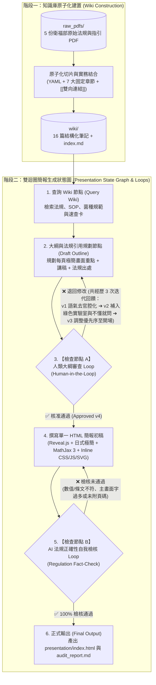

# 衛福部實驗室生物安全與法規知識庫暨教學簡報系統 (TAICA GAI Week 10)

本專案為**「衛生福利部疾病管制署（CDC）實驗室生物安全與法規」**之結構化知識庫（Markdown Wiki）與自動化教學簡報生成專案。透過與 AI Agent 共同擬定之 [`agents.md`](agents.md) 運作規範，將衛福部原始法規與指引 PDF 進行**原子化切片（Atomic Slicing）**，深度結合微生物實驗室四大常態實驗操作，並經由包含**「人類大綱審查（Human-in-the-Loop, HITL）」**與**「AI 法規正確性自我檢核（Self-Correction）」**的雙迴圈狀態圖（State Graph / Loop）流程，最終產出符合**日式極簡風格（Japanese Minimalism）**之單一檔案 Reveal.js 教學簡報。

- 📊 **教學簡報路徑**：[`presentation/index.html`](presentation/index.html)（支援 GitHub Pages 直接播放、MathJax 3 公式渲染、按 `S` 鍵或點擊左下角按鈕展開 `<aside class="notes">` 學長姐講稿與法規出處）
- 🔍 **AI 法規自我檢核報告**：[`presentation/audit_report.md`](presentation/audit_report.md)
- 📚 **Wiki 知識庫總覽索引**：[`wiki/index.md`](wiki/index.md)
- ⚙️ **Agent 核心運作規範**：[`agents.md`](agents.md)

---

## 1. Loop / Graph 狀態機流程設計與圖解

本專案從「原始法規 PDF 解析」到「最終 HTML 簡報輸出」，設計了具備**雙重條件迴圈（Conditional Loops）**之 Graph 工作流，確保知識無幻覺、語氣貼合受眾、且排版嚴守極簡規範：



---

## 2. 【檢查節點 A】人類大綱審查 (HITL) 修改 3 次之完整迭代歷程

在執行 Graph 流程時，系統於 **【檢查節點 A：人類大綱審查 (HITL)】** 暫停，並根據人類專家（指導者）針對目標受眾與實驗室實務文化的回饋，經歷了 **3 次退回修改（共 4 個版本迭代）** 才正式進入程式碼生成階段：

| 版本階段 | 大綱狀態與核心內容 | 人類審查回饋意見 (HITL Feedback) | Agent 修正動作與演進成果 |
| :---: | :--- | :--- | :--- |
| **v1 初稿** | 完整涵蓋 BSL-2 規範、PPE、滅菌確效與鏈球菌四大實驗（BHI 厭氧培養、$\text{OD}_{550}$ 定量、甲醇萃取色素、$-80^\circ\text{C}$ 甘油保存）（共 12 頁）。 | **「考慮受眾絕大部份是 20 歲左右的大學或研究所學生，這個大綱寫得太『官腔官調』了，語氣要輕鬆隨和一點，風格上要作調整。」** | **【退回節點 2 第 1 次修改】**<br/>打破政令宣導公文腔，全面改寫為**「學長姐帶碩一新生／專題生跑實驗室生存指南」**的白話口吻（點出穿拖鞋洞洞鞋、把實驗衣塞書包帶回宿舍洗、戴髒手套按公用電腦等學生真實痛點），同時在 `<aside class="notes">` 完整保留衛福部法規條號與頁碼。 |
| **v2 修正版** | 語氣轉為輕鬆白話的「學長姐口吻」，保留全數法規量化標準與四大實驗闖關主線（共 12 頁）。 | **「補充兩點特別強調：第一，加入『綠色實驗室』概念，儀器不續用隨手關機、滅菌鍋開鍋前招呼大家『搭順風車』別只滅一兩瓶純浪費，水電藥劑手套耗材也要珍惜。第二，做任何事只要有懷疑或不確定，一定先問老師、助教或學長姐，不要自己猜，被罵頂多學起來，猜錯代價很慘。」** | **【退回節點 2 第 2 次修改】**<br/>擴充為 13 頁，新增專頁強調「綠色實驗室（隨手關機、滅菌鍋順風車、節約耗材）」與「不懂就問、千萬別自己猜（被唸兩句總比釀成氣爆或感染好）」，並將節能與發問提醒同步嵌入 BHI 配製、$\text{OD}_{550}$ 分光光度計與高壓滅菌鍋等各頁講稿。 |
| **v3 修正版** | 已納入「綠色實驗室」與「不懂就問別自己猜」，但將該文化專頁安排於簡報後段（Slide 12）。 | **「『不確定要先問』這個很重要，要一開始就要講，不要放在後面。」** | **【退回節點 2 第 3 次修改】**<br/>重排簡報資訊認知優先級：將**「進 Lab 第一天就要記住的兩大鐵則：有懷疑就先問（千萬別自己猜！）＆ 綠色實驗室」**直接拉到封面後的 **Slide 02（開場第一課）**，在講授任何操作技術前先立下最重要的保命心態，並於收尾頁前後呼應。 |
| **v4 定案版** | 開場即立下「不懂就問＋綠色實驗室」鐵則，接續進場資格、PPE、鏈球菌四大實驗關卡、廢液分流、滅菌確效與緊急應變（共 13 頁）。 | **「大綱核准，請開始執行節點 4 與節點 5。檔名改為 `index.html` 以利部署 GitHub Pages，並堅守日式極簡與 `<aside class="notes">` 分離原則。」** | **【核准通過 (Approved)】**<br/>進入節點 4 撰寫 [`presentation/index.html`](presentation/index.html) 及節點 5 產出 [`presentation/audit_report.md`](presentation/audit_report.md)。 |

---

## 3. 作業反思報告 (Reflection Report)

### 3.1 規範先行 (`agents.md`) 與原子化知識庫 (`wiki/`) 對消除 AI 幻覺的關鍵作用
在處理衛福部疾管署共計超過 240 頁的五份法規與查核手冊 PDF 時，若直接要求 LLM 由原始 PDF 一步生成簡報，極易發生「數值張冠李戴」或「遺漏細節規範」的幻覺（Hallucination）。本專案透過兩階段架構解決此問題：
1. **第一階段（先與人對齊 `agents.md` 再動手建庫）**：先定義清楚檔案命名、7 大強制章節（含紅線警語、稽核表單、精確到頁碼的法規出處）與四大常態實驗關注維度，將 5 份 PDF 拆解為 16 篇高內聚力的原子化 Markdown 筆記與 `[[專有名詞]]` 雙向連結網路。
2. **第二階段（基於結構化 Wiki 與速查卡生成簡報）**：當製作教學簡報時，Agent 不必在大海撈針的原始 PDF 中重新推論，而是直接檢索已將「法規條文」與「鏈球菌常態實驗（BHI 厭氧培養、$\text{OD}_{550}$、甲醇萃取、$-80^\circ\text{C}$ 保存）」深度綁定的 Wiki 筆記與 Cheat Sheets，使最終簡報的法規正確率達到 100%。

### 3.2 為什麼同時需要「人類大綱審查 (HITL Loop)」與「AI 法規自我檢核 (Self-Correction Loop)」？
本次作業最深刻的心得，在於見證了 **Human Loop** 與 **AI Loop** 兩者截然不同且互補的價值：
- **AI 自我檢核 Loop（檢查節點 B）擅長「硬性法規與技術合規」**：
  AI 能滴水不漏地逐頁比對量化數值——例如確認生物安全櫃與高壓滅菌器兩次定檢間隔「不得超過 15 個月」（查核手冊 p. 52）、離心管於未封閉轉子破裂須「靜置 30 分鐘」且內腔「擦拭兩次」（意外事故指引 p. 2–3）、BSC 外氣膠釋放須封鎖「1 小時／無中央排氣 24 小時」、無菌保證水準 $\text{SAL} < 10^{-6}$ 與「連續三次成功紀錄」（確效手冊 p. 3），以及檢查 HTML 是否符合單一檔案與 MathJax 渲染規範。
- **人類大綱審查 Loop（檢查節點 A）擅長「受眾同理心、隱性文化與價值排序」**：
  即便 v1 大綱在法規上完全正確，人類指導者一眼就能看出「對 20 歲的大學生與研究生來說太官腔官調，學生根本聽不進去」，並進一步注入法規條文不會寫、卻攸關實驗室生死與永續經營的兩大實務智慧：**「只要有懷疑就先問老師與學長姐，千萬別怕被罵而自己亂猜」**以及**「綠色實驗室：隨手關機、滅菌鍋揪團搭順風車」**，甚至精準指示將「不確定先問」移到簡報一開場的第 2 頁。這種教學現場的洞察力與認知優先序調整，正是 Human-in-the-Loop 無可取代的核心價值。

### 3.3 「日式極簡畫面 $+$ `<aside class="notes">` 講者備忘錄」解決法規簡報的兩難
傳統生安法規簡報常陷入兩種極端：不是把密密麻麻的法條全塞上投影片變成「念稿催眠大會」，就是只放幾張圖卻讓學生課後複習時找不到正確的SOP數據。透過 Reveal.js 的日式極簡設計（和紙白留白、每頁僅 3 點直白口訣與內嵌 SVG 圖）搭配 `<aside class="notes">` 講者備忘錄（以及左下角一鍵展開的講稿抽屜），成功讓**「上課投影時視覺清爽抓重點」**與**「課後自學時擁有完整學長姐白話詳解與法規頁碼出處」**兩全其美。

---

## 4. 專案目錄架構與檔案導覽

```text
project_root/
├── README.md                 # 專案總覽、Loop/Graph 流程圖解、3 次大綱修改歷程與作業反思報告
├── agents.md                 # Agent 核心運作規範與流程定義
├── raw_pdfs/                 # 衛福部疾管署原始法規、指引與查核手冊 PDF（唯讀查核基準，共 5 份）
├── wiki/                     # 原子化切片後之結構化 Markdown 知識庫（共 16 篇筆記 + 總覽索引）
│   ├── index.md              # 知識庫總覽與 [[專有名詞]] 雙向連結索引
│   ├── regulations/          # 法規條文與查核基準解析（管理辦法、生物安全規範、115 年查核手冊）
│   ├── sop_guides/           # 實務操作 SOP（BSC、PPE、清潔除汙與廢液分流、高壓滅菌鍋、緊急應變）
│   ├── microbes/             # 鏈球菌四大常態實驗規範（BHI 厭氧培養、OD550 定量、甲醇萃取色素、-80°C 甘油保存）
│   └── cheatsheets/          # 單頁實務檢核速查卡（CS_01 ～ CS_04）
├── assets/                   # 視覺素材暫存區
│   ├── images/               
│   └── diagrams/             
└── presentation/             # 最終簡報與自我檢核產物目錄
    ├── index.html            # 單一檔案 Reveal.js 日式極簡教學簡報（支援 MathJax 3 與 Speaker Notes）
    └── audit_report.md       # 【檢查節點 B】AI 法規正確性自我檢核報告
```
