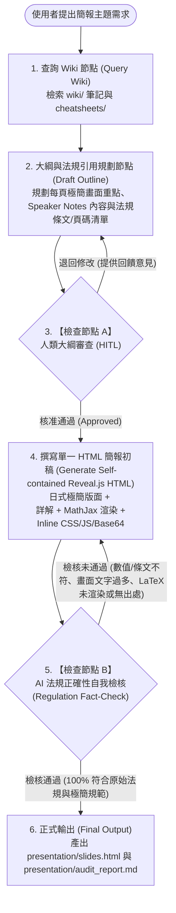

# 衛福部實驗室生物安全與法規知識庫 — Agent 運作規範 (agents.md)

## 1. 專案目標與角色定位
本專案旨在管理「衛生福利部疾病管制署（CDC）實驗室生物安全與法規」知識庫，將原始法規與指引 PDF 轉化為結構化、可實務應用的 Markdown 知識庫（Wiki），並透過嚴謹的 Graph 流程（含人類審查與 AI 法規正確性自我檢核），產出供實驗室人員直接閱讀的**單一檔案（Self-contained）Reveal.js HTML 教學簡報**。

---

## 2. 資料夾結構與命名規範

### 2.1 目錄架構
專案採「處理階段與知識類型」分層管理：
```text
project_root/
├── agents.md                 # Agent 核心運作規範與流程定義
├── raw_pdfs/                 # 衛福部原始法規、指引 PDF 檔案（唯讀，作為查核基準）
├── wiki/                     # 解析並結構化後的 Markdown 知識庫
│   ├── index.md              # 知識庫總覽與交叉索引目錄
│   ├── regulations/          # 法規條文解析（如：感染性生物材料管理辦法）
│   ├── sop_guides/           # 實務操作指引（如：BSL-2 操作規範、滅菌確效、PPE、廢棄物處理）
│   ├── microbes/             # 特定病原體／菌種規範（如：鏈球菌屬 Streptococcus 厭氧培養與防護）
│   └── cheatsheets/          # 微生實驗情境速查卡（跨法規單頁檢核表）
├── assets/                   # 原始圖檔與視覺素材暫存區（供轉換為 Base64 或 SVG 內嵌前使用）
│   ├── images/               # 擷取自法規之照片、設備圖、PPE 穿脫流程圖
│   └── diagrams/             # Mermaid / SVG 原始圖表定義
└── presentation/             # 最終簡報與檢核產物目錄
    ├── slides.html           # 單一檔案 Reveal.js HTML 教學簡報（支援 MathJax CDN 與 inline 自訂 CSS/JS/Base64 圖檔）
    └── audit_report.md       # AI 法規正確性自我檢核報告
```

### 2.2 檔案命名規則
- **原始 PDF (`raw_pdfs/`)**：`YYYYMMDD_<發布機關>_<法規或指引標準簡稱>.pdf`
  - 範例：`20260315_CDC_實驗室生物安全規範.pdf`
- **Wiki 筆記 (`wiki/{category}/`)**：`YYYYMMDD_<主題或法規簡稱>.md`（日期為法規發布/修訂日或建檔日）
  - 範例：`20260315_BSL2_鏈球菌厭氧培養與BHI培養基規範.md`
- **速查卡 (`wiki/cheatsheets/`)**：`CS_<實驗情境代碼>_<情境名稱>.md`
  - 範例：`CS_01_高壓滅菌鍋生物指示劑確效檢核表.md`

---

## 3. 知識萃取重點與 Markdown 結構模板

解析 `raw_pdfs/` 轉換為 `wiki/` 筆記時，禁止僅做純文字摘要，**必須著重提取實驗室第一線人員可直接執行的實務規範**。

### 3.1 核心萃取維度與常態性實驗項目（預設關注範圍）
解析法規與指引時，必須預設關注以下常態性微生物實驗操作，特別留意各步驟中**可能產生的氣膠（Aerosol）風險、化學品與生物危害複合防護，以及對應的生物安全櫃（BSC）與 PPE 規範**：

1. **常態性微生物實驗項目（重點對應）**：
   - **鏈球菌（*Streptococcus* spp.）之 BHI 培養液厭氧靜置培養**：
     - BHI（Brain Heart Infusion）液態培養基之配置、分裝、高壓滅菌，以及厭氧靜置培養過程（如厭氧缸/厭氧袋開啟、培養管取樣、搖勻或混勻操作）之氣膠防範與溢灑處理。
   - **分光光度計 $\text{OD}_{550}$ 菌液定量**：
     - 感染性菌液移液（Pipetting）至比色管（Cuvette）或微量盤之氣膠控制、攜出生物安全櫃（BSC）至分光光度計量測時之密閉容器／表面除污規範，以及比色管使用後之消毒與感染性廢棄物處置。
   - **甲醇（Methanol）萃取色素步驟**：
     - 菌體離心收集、甲醇添加、震盪混勻（Vortexing）、離心分離上清液等步驟中，**「感染性生物氣膠」與「有機溶劑（易燃／毒性蒸氣）」之複合風險管控**（如：禁止於無排氣之循環式 BSC 內大量使用揮發性易燃有機溶劑、離心機安全杯／密封轉子於 BSC 內裝卸規範、耐溶劑手套選用）。
   - **-80°C 甘油冷凍保存（Glycerol Stock）操作**：
     - 高濃度菌液與甘油混勻、分裝至冷凍小管（Cryovial）、防爆管選用、冷凍盒移入 -80°C 超低溫冷凍櫃之生物材料帳籍管理（RG2 菌株異動／保存紀錄），以及解凍時防範管體爆裂與氣膠噴濺之 PPE（如面罩／護目鏡、防凍與雙層手套）。
2. **個人防護裝備（PPE）**：
   - 進退 P2 (BSL-2) 實驗室之標準穿脫順序，以及針對上述厭氧培養、離心、甲醇萃取、冷凍管操作之專屬防護裝備（實驗衣、雙層手套與材質相容性、眼部/面部防護、呼吸防護）。
3. **感染性廢棄物處理與滅菌確效**：
   - 高壓蒸氣滅菌鍋（Autoclave）操作參數（溫度、壓力、時間），以及含甲醇等化學溶劑之混合廢液與純生物廢棄物之分流處置（嚴禁將有機溶劑直接進高壓滅菌鍋）。
   - **滅菌確效（Validation）**：生物指示劑（Biological Indicator，如嗜熱桿菌芽孢 *Geobacillus stearothermophilus*）與化學指示劑（包內/包外）之定期檢測頻率、培養判定標準與不合格處置流程。
4. **紅線警語與必備紀錄表單**：
   - 明確標示法規罰則、高風險禁忌操作（如禁止將感染性液體直接傾倒水槽、禁止將含甲醇廢液直接高壓滅菌）及稽核必備紀錄表單。

### 3.2 標準筆記強制模板（YAML + 固定章節）
每篇 `wiki/` 筆記必須包含以下結構：
```markdown
---
title: "<文件標題>"
source_pdf: "raw_pdfs/<原始檔名>.pdf"
bsl_level: ["BSL-2"]
tags: ["鏈球菌", "BHI厭氧靜置培養", "OD550定量", "甲醇萃取色素", "-80C甘油冷凍保存", "氣膠防護", "滅菌確效", "PPE"]
last_verified: "YYYY-MM-DD"
---

# <主題名稱>

## 1. 適用範圍與生物安全等級 (BSL Level)
## 2. 實務操作 SOP 與技術規範（對應常態實驗：BHI 厭氧培養、OD550 定量、甲醇萃取、-80°C 甘油保存之氣膠與安全控制）
## 3. 個人防護裝備 (PPE) 要求
## 4. 感染性廢棄物處理與滅菌確效規範
## 5. 🚨 紅線警語（高風險操作禁忌與違規罰則）
## 6. 📋 稽核必備紀錄表單清單
## 7. 📖 法規條文出處索引（必須精確標註原始 PDF 檔名、條號與頁碼）
```

### 3.3 微生實驗情境速查卡（Cheat Sheet）
於 `wiki/cheatsheets/` 針對高頻率實驗情境（如「鏈球菌 BHI 厭氧培養至色素萃取與冷凍保存全流程安全檢核」、「高壓滅菌鍋生物指示劑確效檢核」），跨法規彙整成單頁 Markdown 檢核清單（Checklist），供製作教學簡報時直接引用。

---

## 4. 簡報視覺與內容呈現規範 (HTML / Reveal.js)

最終輸出於 `presentation/slides.html` 的教學簡報，必須嚴格遵守以下視覺、內容與技術規範：

### 4.1 日式極簡風格 (Japanese Minimalism)
- **框架與美學**：請使用 **Reveal.js** 框架，採用「日式極簡風格（Japanese Minimalism）」，強調**大量留白（Whitespace / Ma 間）**、排版乾淨俐落，**避免複雜的視覺裝飾**。
- **版面與配色**：視覺重心穩定，使用溫潤低彩度背景（如和紙白 `#FAF8F5` 或極淺灰）搭配深炭灰文字（`#2C2C2C`）與單一重點強調色（如朱印紅 `#C83E2B` 用於紅線警語、松葉綠 `#3A5A40` 用於安全規範），不加花俏漸層或多餘邊框。

### 4.2 極簡畫面與講者輔助稿（Speaker Notes 分離原則）
- **投影片畫面極簡化**：投影片畫面上**絕對不能塞滿文字**，請只保留：
  1. 最核心的主標題／副標題
  2. 精煉的大字點列（Bullet points，每頁不超過 3～4 點，每點不超過一行）或關鍵圖像
- **詳細條文與囉嗦細節說明全數藏入 `<aside class="notes">`**：
  - 詳細的法規條文原文、實務操作解釋、背後科學原理、具體頁碼出處與囉嗦的細節說明，**請全部使用 Reveal.js 的 `<aside class="notes">...</aside>` 標籤，藏入講者備忘錄（Speaker Notes）中作為輔助稿**，確保主畫面極致乾淨。

### 4.3 LaTeX 數學與化學式渲染
- **MathJax 與 Reveal.js Math 插件**：若簡報中包含 LaTeX 語法（如計算公式、菌液濃度、光密度 `$OD_{550}$` 或化學式），**請透過 CDN 引入 MathJax 函式庫，並啟用 Reveal.js 的 `RevealMath`（如 `RevealMath.MathJax3`）插件**，以保證 HTML 中能完美渲染所有數學與化學符號。

### 4.4 單一檔案結構與圖檔內嵌規範
- **單一 HTML 檔案（Self-contained HTML）原則**：
  - 除上述必要的 **MathJax / Reveal.js CDN 腳本與核心樣式**外，請盡可能遵守「單一 HTML 檔案」原則。
  - 所有其他**自訂 CSS 樣式**（日式極簡主題微調）與**自訂 JS 設定腳本**必須 **inline 寫入本機 `presentation/slides.html` 檔案中**，不額外拆分外部本機 `.css` 或 `.js` 檔。
- **圖檔與圖表嵌入規範**：
  - 流程圖與示意圖優先使用內嵌 **SVG**。
  - 若需使用外部圖檔（存於 `assets/images/`），**請優先轉換為 Base64 Data URI (`data:image/...;base64,...`) 直接嵌入 HTML 中**，確保單一 HTML 檔案即可完整呈現所有圖文。

---

## 5. Graph 流程設計（從『查詢 Wiki』到『產出 HTML』）

Agent 執行教學簡報生成任務時，必須遵循以下狀態圖（State Graph）與節點規範：



### 關鍵檢查節點規範：

1. **【檢查節點 A】人類大綱審查 (Human-in-the-Loop, HITL)**：
   - **執行動作**：Agent 產出「簡報分頁大綱（區分『畫面極簡重點』與『`<aside class="notes">` 講者輔助稿重點』）」、「涵蓋之實務實驗情境（如鏈球菌 BHI 厭氧靜置培養、$OD_{550}$ 定量、甲醇萃取色素、-80°C 甘油保存、滅菌確效）」與「預計引用的法規條文出處清單」後，**必須暫停並等待人類審查**。
   - **通過條件**：人類明確回覆確認或核准後，方可進入 HTML 撰寫階段；若人類提出修改意見，則回到大綱規劃節點重新調整。

2. **【檢查節點 B】AI 自我檢核法規正確性 (Self-Correction & Fact-Checking)**：
   - **執行動作**：HTML 初稿完成後，Agent 必須將簡報畫面與 `<aside class="notes">` 中的所有規範敘述逐一比對 `wiki/` 筆記與 `raw_pdfs/` 原始條文，重點查核：
     - **量化數值正確性**：如高壓滅菌溫度（121°C / 132°C）、時間、壓力、消毒酒精/漂白水濃度、離心靜置等待氣膠沉降時間、-80°C 冷凍保存規範等是否與衛福部規範完全一致。
     - **常態實驗氣膠與複合風險相符性**：如鏈球菌 BHI 厭氧培養、$OD_{550}$ 比色管操作、甲醇萃取（有機溶劑與生物氣膠雙重風險）、甘油冷凍管操作之 BSL 等級、BSC 使用限制與 PPE 穿戴項目是否正確無誤。
     - **法規來源可追溯性**：每頁的 `<aside class="notes">` 是否皆已附上正確的法規名稱、條號或指引頁碼，嚴禁幻覺（Hallucination）或無根據之推論。
     - **視覺與結構合規性**：確認是否符合日式極簡留白、主畫面無冗長段落、已正確透過 CDN 載入 MathJax 與啟用 Reveal.js Math 插件渲染 LaTeX 公式（如 `$OD_{550}$`），且所有自訂 CSS/JS 與 Base64 圖片皆已 inline 寫入單一 HTML 檔。
   - **退回機制**：若發現任何一項數值錯誤、遺漏紅線警語、無出處引用或違反單一檔案／極簡排版／LaTeX 渲染原則，系統自動退回「撰寫 HTML 初稿」節點修正，直到全數通過檢核，並同步產出 `presentation/audit_report.md` 留存查核紀錄。
