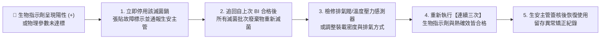

# 微生實驗情境速查卡 CS-02：高壓蒸氣滅菌鍋生物指示劑確效與日常監控檢核表

> **關聯筆記**：[[20210604_SOP_高壓蒸氣滅菌鍋操作與生物指示劑確效規範]] | [[20210604_SOP_實驗室清潔除汙與感染性廢棄物分類處置規範]] | [[20260417_115年BSL2實驗室暨RG2保存場所查核基準與自評實務]]

---

## 1. 適用範圍與生物安全等級 (BSL Level)

本速查卡適用於[[BSL-2]]實驗室執行[[高壓蒸氣滅菌鍋]]（Autoclave）之**初次／年度熱研究確效**、**定期[[生物指示劑]]（Biological Indicator, BI）挑戰測試**，以及**每鍋次日常感染性廢棄物與[[BHI厭氧靜置培養]]基滅菌監控**之實務檢核。

- **法定無菌保證基準**：依據《滅菌過程確效作業指導手冊》第二章三（p. 3），**最終滅菌過程之無菌保證水準（Sterility Assurance Level, SAL）必須優於 $10^{-6}$**。

---

## 2. 實務操作 SOP 與技術規範（三層級滅菌確效與監控檢核清單）

### 2.1 第一層級：每鍋次日常操作與物理／化學監控檢核（Routine Load Checklist）
- [ ] **禁入物品排查（防爆紅線）**：確認裝載物中**絕對不含[[甲醇萃取色素]]廢液等揮發性有機溶劑、不含次氯酸鈉（漂白水）、不含強酸強鹼或密閉高壓氣瓶**（規範第 3.7.11 條）。
- [ ] **裝載方式與蒸氣通道**：
  - [ ] 感染性廢棄物裝於專用耐高溫滅菌袋，裝載量不超過 $70\%\sim 80\%$，**袋口微開或使用透氣束帶（嚴禁完全綁死密封）**，並置於不鏽鋼或 PP 防漏二次托盤中。
  - [ ] 液態培養基（如 BHI）或廢菌液玻璃瓶，液面不超過容量 $75\%$，**螺旋瓶蓋必須旋鬆半圈至一圈**（嚴禁鎖死）。
- [ ] **物理參數監控（規範第 3.7.14、3.7.15 條）**：
  - [ ] 確認滅菌溫度（如 **$121^\circ\text{C}$** 或 $132^\circ\text{C}$）、飽和蒸氣壓力（約 $1.05\sim 1.2\text{ kg/cm}^2$）與維持滅菌停留時間（廢棄物 $\ge 30\sim 60\text{ min}$；BHI 培養基 $15\sim 20\text{ min}$）符合已確效之[[代表性負載量]]設定。
- [ ] **化學指示劑（Chemical Indicator, CI）查證**：
  - [ ] 每袋／每瓶外部黏貼**包外化學指示膠帶**（確認條紋完全變色）。
  - [ ] 袋內中心放置**包內多參數化學指示卡／條**（確認蒸氣已穿透至裝載物內部）。

### 2.2 第二層級：定期生物指示劑（BI）確效檢核（Periodic Biological Validation Checklist）
- [ ] **生物指示劑規格確認（《確效手冊》p. 3–4；規範第 5.1.4 條）**：
  - [ ] 選用蒸氣滅菌專用之**嗜熱脂肪芽孢桿菌（*Geobacillus stearothermophilus*，ATCC 7953）自含式生物指示劑（Self-contained BI）**，確認菌數（$\ge 10^6\text{ spores}$）、$D_{121}$ 值、$Z$ 值及有效期限。
- [ ] **最難滅菌位置（冷點 Cold Spot）埋設（《確效手冊》p. 4）**：
  - [ ] 將[[生物指示劑]]置於透氣測試管或包內，埋入[[代表性負載量]]（Representative Load）中**最難滅菌之裝載產品及位置（如滅菌袋中心最底層、近排水排氣口處）**。
- [ ] **培養與陽性對照組同步測試**：
  - [ ] 滅菌結束待冷卻後取出測試組 BI，夾破內含培養基安瓿，置於 $55^\circ\text{C}\sim 60^\circ\text{C}$ 專用培養器培養 $24\sim 48$ 小時（或依快速螢光判讀儀時間）。
  - [ ] **必須同步培養 1 支「未經滅菌、同批號」之陽性對照組（Positive Control）**。
- [ ] **合格判定標準**：
  - [ ] **滅菌測試組**：維持紫色／原色（**陰性 $-$，無芽孢生長**）。
  - [ ] **陽性對照組**：轉為黃色混濁或螢光陽性（**陽性 $+$，確認芽孢活性與培養器溫度正常**）。
  - *註：陽性對照組觀察完畢後，必須經高壓蒸氣滅菌後始得丟棄！*

### 2.3 第三層級：初次／年度熱研究與再確效檢核（Annual & Re-validation Checklist）
- [ ] **強制再確效時機（規範第 4.8.10、5.1.1 條；查核手冊 p. 38、52）**：
  - [ ] 初次安裝使用前、重大維修後、裝載型式或流程重大改變、引進新病原體，以及**每年定期確效（兩次檢測確效間隔不得超過 15 個月）**。
- [ ] **熱分佈與熱滲透連續三次成功紀錄（《確效手冊》第二章二，p. 3）**：
  - [ ] 熱探測器（Thermocouples）於使用前後均已完成校正。
  - [ ] 執行最小及最大裝載量之熱滲透試驗，記錄各點最高／最低溫度、平均溫度、達到滅菌溫度時間及最高／最低 $F_0$ 值。
  - [ ] **滅菌確效紀錄必須具備「連續三次成功」之結果**，證明均一性與再現性。

---

## 3. 個人防護裝備 (PPE) 要求

- [ ] **開鍋卸載專屬 PPE**：穿戴 BSL-2 長袖實驗衣、包覆式防滑鞋、**長袖防熱隔熱手套（Heat-Resistant Gloves）**及**全罩式防護面罩（Face Shield）**（防範殘餘高溫蒸氣與過熱液體突沸噴濺燙傷）。

---

## 4. 感染性廢棄物處理與滅菌確效不合格應變流程

---

## 5. 🚨 紅線警語（高風險操作禁忌與違規罰則）

> [!CAUTION]
> **滅菌鍋操作與查核四大紅線**
> 1. **嚴禁僅用「包外滅菌指示膠帶」取代生物指示劑（BI）定期確效**：衛生局查核（《115年查核作業手冊》p. 38）明確要求查驗生物指示劑確效紀錄。
> 2. **嚴禁年度檢測與確效間隔超過 15 個月**：違反《115年查核作業手冊》p. 52 規定。
> 3. **嚴禁壓力未歸零或液體未降溫至 $80^\circ\text{C}$ 以下時強行開門**：將引發過熱 BHI 培養液或廢菌液劇烈突沸炸裂。
> 4. **嚴禁將含甲醇、乙醚等易燃有機溶劑或含氯漂白水送入高壓滅菌鍋**。

---

## 6. 📋 稽核必備紀錄表單清單（保存至少 3 年）

1. 《高壓蒸氣滅菌鍋日常使用參數（溫度／壓力／時間）暨化學指示劑紀錄表》
2. 《高壓蒸氣滅菌鍋定期生物指示劑（*G. stearothermophilus*）確效與陽性對照判定紀錄表》
3. 《高壓蒸氣滅菌鍋年度熱分佈／熱滲透連續三次確效報告書（含代表性負載量圖表与探針校正報告）》（間隔 $\le 15$ 個月）

---

## 7. 📖 法規條文出處索引（必須精確標註原始 PDF 檔名、條號與頁碼）

- **`raw_pdfs/滅菌過程確效作業指導手冊.pdf`**：第一章、第二章一至三（第 2–4 頁：代表性裝載型式、最低／最高 $F_0$ 值、熱探測器前後校正、**連續三次成功結果**、**$\text{SAL} < 10^{-6}$**、生物指示劑 $D$ 值／$Z$ 值、最難滅菌位置微生物挑戰實驗）。
- **`raw_pdfs/實驗室生物安全規範_110.06.04`**：名詞定義 #94、#108、#110（第 10–12 頁）；第 3.7.14、3.7.15、4.8.10、4.8.11、5.1.1、5.1.4 條（第 35、49、53 頁）。
- **`raw_pdfs/6c1ee800-62df-4255-9d1a-dbe10af6906a.pdf`（《115年查核作業手冊》）**：第 38 頁（高壓滅菌器管理與生物指示劑確效）、第 52 頁（年度檢測間隔不得超過 15 個月）。
