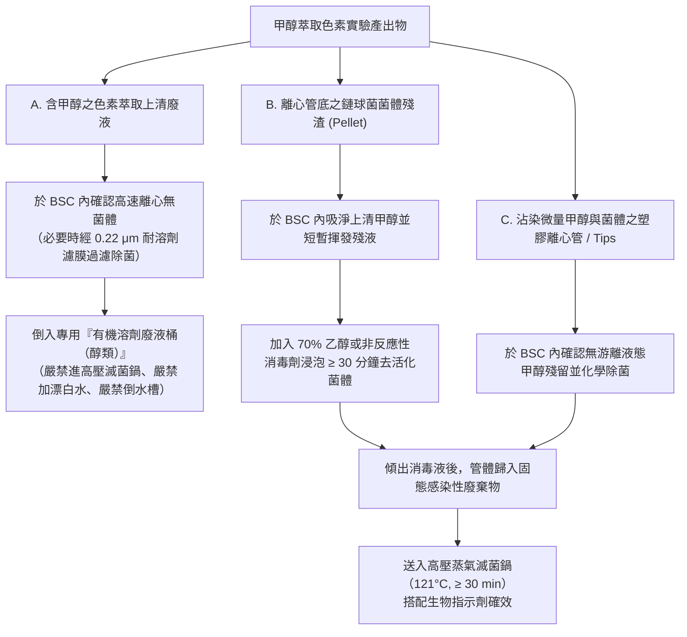

# BSL-2 甲醇 (Methanol) 萃取色素之生物氣膠與有機溶劑複合風險管控規範

> **關聯筆記**：[[20210604_SOP_生物安全櫃BSC與初級阻隔裝置操作維護規範]] | [[20210604_SOP_實驗室清潔除汙與感染性廢棄物分類處置規範]] | [[20260623_SOP_實驗室意外事故與感染性氣膠溢灑緊急應變規範]] | [[CS_01_鏈球菌BHI厭氧培養至色素萃取與冷凍保存全流程安全檢核表]]

---

## 1. 適用範圍與生物安全等級 (BSL Level)

本規範適用於在[[BSL-2]]實驗室中，針對完成[[BHI厭氧靜置培養]]與[[分光光度計OD550定量]]後之[[鏈球菌]]（*Streptococcus* spp.，屬[[第二級危險群]] RG2），執行高速離心收集菌體（Pellet）、添加甲醇（Methanol, $\text{CH}_3\text{OH}$）懸浮、漩渦振盪混勻（Vortexing）萃取菌體色素，以及再次離心分離色素上清液之全流程操作。

### 1.1 「感染性生物氣膠」與「易燃／毒性有機溶劑」雙重複合危害分析（規範第 2.13 節）
本實驗步驟為微生物實驗室最具代表性之**「生物危害 $+$ 化學危害」複合風險（Compound Risk）情境**：
1. **高濃度 RG2 生物氣膠危害**：離心濃縮後之[[鏈球菌]]菌體沉澱濃度極高（可達 $10^9\sim 10^{10}\text{ CFU/mL}$），於高速離心、吸除上清液及 Vortex 劇烈振盪時，極易產生高濃度[[感染性氣膠]]。且在甲醇完全滲透殺死所有菌體前，懸浮液仍具潛在感染性。
2. **甲醇（$\text{CH}_3\text{OH}$）之化學毒性與火災爆炸危害**：
   - **高度易燃**：甲醇閃火點（Flash Point）僅約 $11^\circ\text{C}$，沸點 $64.7^\circ\text{C}$，爆炸極限（LEL–UEL）為 $6.0\%\sim 36.5\%$（$v/v$），其蒸氣與空氣混合極易被靜電、馬達火花或加熱器引燃。
   - **急性與慢性毒性**：甲醇蒸氣經呼吸道吸入或液體經皮膚吸收、噴濺入眼，在體內代謝為甲醛與甲酸，可引起代謝性酸中毒、視神經病變甚至永久失明。
3. **設備相容性衝突（核心管控難題）**：
   - 一般實驗室常見之 **II 級 A2 型[[生物安全櫃]]（Class II Type A2 BSC）** 係將 $70\%$ 氣流經[[HEPA過濾器]]過濾後循環回工作區，僅 $30\%$ 排回實驗室室內。**[[HEPA過濾器]]僅能攔截微粒與細菌，完全無法吸附或過濾甲醇有機溶劑蒸氣**！
   - 若在無獨立外排氣管路之循環式 BSC 內大量敞開使用甲醇，甲醇蒸氣將在 BSC 內部與風機馬達艙高濃度累積，引發**電氣火花氣爆**或由排氣口直接吹向操作者面部造成**吸入中毒**；反之，若直接在無 HEPA 過濾之一般化學排氣櫃（Chemical Fume Hood）敞開操作活菌，又可能缺乏無菌層流保護或將活菌氣膠直接排向大氣。

---

## 2. 實務操作 SOP 與技術規範（對應常態實驗：BHI 厭氧培養、OD550 定量、甲醇萃取、-80°C 甘油保存之氣膠與安全控制）

### 2.1 步驟一：初級菌液離心與密封安全杯強制規範（規範第 4.6.27 條；意外事故指引三、(五)~(六)）
1. **BSC 內裝載密封安全杯（Safety Cups）**：
   - 於經驗證合格之[[生物安全櫃]]（BSC）內，將定量後之[[鏈球菌]] BHI 菌液分裝入耐有機溶劑之聚丙烯（PP）離心管（確認管體無裂痕，裝液量不超過 $75\%$），旋緊管蓋。
   - **強制裝入封閉式[[離心機安全杯]]（Safety Cups）或密封轉子（Sealed Rotor）**：依據《實驗室生物安全規範》第 4.6.27 條及《意外事故指引》三、(六)（p. 3），**所有封閉式離心桶都必須在 BSC 內進行裝載與旋緊密封蓋**，經表面擦拭[[除汙]]後方可移至離心機進行離心。
2. **BSC 內卸載與吸除上清液**：
   - 離心結束後，**嚴禁在離心機旁直接打開安全杯蓋**。必須將密封安全杯完整移回 **BSC 內**，先透過透明蓋檢視有無離心管破裂洩漏，確認無異常後方可在 BSC 內開蓋取出離心管。
   - 於 BSC 內使用微量吸管緩慢吸除 BHI 上清廢液，排入含 $0.5\%$ 次氯酸鈉之廢液瓶中（嚴禁直接傾倒以免管口液滴飛濺）。

### 2.2 步驟二：甲醇添加與 Vortex 振盪混勻之複合風險控制（規範第 3.7.1、3.7.3、4.6.23、4.6.29 條）
1. **設備選擇與溶劑用量控管**：
   - **優先選用外排氣型安全櫃**：若涉及較大量甲醇操作，應於 **II 級 B2 型（$100\%$ 全排氣型，具備防回噴機制，條號 3.7.3）** 或連接外排氣罩（Canopy / Thimble Connection）之 II 級 A2 型 BSC 內執行。
   - **微量密閉操作原則（若僅有標準循環式 Class II A2 BSC）**：
     - 每次僅於 BSC 內移取微量（如每管 $0.5\sim 2\text{ mL}$）甲醇加入菌體沉澱管中，甲醇原液儲備瓶隨開隨蓋，**嚴禁在 BSC 內敞開大口燒杯盛裝甲醇或進行加熱揮發**。
     - **絕對禁止開啟任何明火或高溫加熱設備（條號 4.6.29）**，防範引燃甲醇蒸氣。
2. **雙重密封 Vortex 振盪 SOP（條號 4.6.23、4.6.32）**：
   - 加入甲醇後，於 BSC 內將離心管螺旋蓋完全鎖緊，並於**管蓋接縫處纏繞耐溶劑封口膜（或置入二次密閉保護管）**。
   - 於 BSC 內進行漩渦振盪（Vortexing）使菌體懸浮並萃取色素；操作時以手指壓住管蓋頂端防止鬆脫。
   - **振盪後強制靜置**：Vortex 完畢後，離心管內部充滿含甲醇與菌體碎片之微細液滴，**必須在 BSC 內靜置等待至少 $2\sim 3$ 分鐘**讓氣膠沉降，若需開蓋必須於 BSC 內緩慢旋開。

### 2.3 步驟三：甲醇萃取液二次離心與上清液分離
1. **二次密封離心**：
   - 將含甲醇與菌體之離心管再次於 **BSC 內**裝入[[離心機安全杯]]（確認 O-ring 墊圈完好且耐醇類溶劑），密封後移至離心機離心（建議採用具溫控之冷凍離心機設定於 $4^\circ\text{C}\sim 15^\circ\text{C}$，降低高速旋轉摩擦溫升造成之甲醇蒸氣壓上升）。
2. **BSC 內分離色素上清液**：
   - 離心完畢後將[[離心機安全杯]]移回 **BSC 內**開啟，以微量吸管吸取上層含色素之甲醇萃取液至附蓋耐溶劑樣品管或石英比色管中，立即加蓋密封並以[[70%乙醇]]擦拭外壁除汙。

---

## 3. 個人防護裝備 (PPE) 要求

執行[[甲醇萃取色素]]步驟時，必須同時防範[[鏈球菌]]生物暴露與甲醇化學傷害（規範第 3.4.1、4.4.1～4.4.4 條）：

1. **耐溶劑丁腈手套（Nitrile Gloves，強制雙層或加厚型）**：
   - 一般天然乳膠手套（Latex）及聚氯乙烯手套（PVC）對甲醇之抗滲透能力極差，數分鐘內即會發生分子級穿透。
   - 操作人員**必須穿戴丁腈（Nitrile）手套（建議穿戴雙層丁腈手套）**；一旦外層手套沾染甲醇或菌液，應立即脫除更換，防止甲醇經皮膚吸收。
2. **防化學噴濺護目鏡或全罩式防護面罩（規範第 4.4.2 條）**：
   - 將安全杯移出 BSC 放入離心機、或於排氣櫃／分光光度計操作含甲醇樣品時，**必須全程配戴防化學噴濺護目鏡或全罩式面罩**。
   - 操作前確認實驗室**洗眼器或緊急沖身洗眼器**（規範第 3.6.6 條）暢通無阻；若甲醇混合液不慎噴入眼睛，必須立即撐開眼瞼以洗眼器持續沖洗至少 $15$ 分鐘並就醫。
3. **耐化學品長袖實驗衣與完全包覆防滑鞋（規範第 4.4.1、4.6.3 條）**。

---

## 4. 感染性廢棄物處理與滅菌確效規範

### 4.1 含甲醇複合廢棄物之絕對分流處置原則（稽核與安全最高核心）
[[甲醇萃取色素]]步驟產生之廢棄物兼具「潛在殘留活菌」與「易燃毒性溶劑」雙重特性，**絕對不可比照一般水相 BHI 菌液處理**：

1. **A 類（液態甲醇上清廢液）**：
   - 於 BSC 內確認已離心移除菌體（或經 $0.22\ \mu\text{m}$ PTFE/Nylon 耐溶劑濾膜過濾完成物理除菌）後，集中收集於貼有危害標示之 HDPE 專用「**有機溶劑廢液桶（含醇類）**」，交由合格化學廢液處理廠商清運。
2. **B 類與 C 類（離心管底菌體沉澱 Pellet 與耗材）**：
   - 於 BSC 內將殘餘液態甲醇完全吸除，加入適量 **[[70%乙醇]]水溶液**浸泡作用 $\ge 30$ 分鐘確保殘存[[鏈球菌]]完全去活化（避免直接將高濃度次氯酸鈉漂白水加入殘留大量甲醇之管內，以防產生鹵代烴副產物與放熱反應），吸除液體後，確認管內無游離液態甲醇，再將空管投入感染性廢棄物袋進行[[高壓蒸氣滅菌鍋]]滅菌。

---

## 5. 🚨 紅線警語（高風險操作禁忌與違規罰則）

> [!CAUTION]
> **甲醇萃取色素步驟五大致命與法規紅線**
> 1. **嚴禁將含有液態甲醇之離心管、血清瓶或廢液送入[[高壓蒸氣滅菌鍋]]**：在 $121^\circ\text{C}$ 高溫密閉滅菌腔中，甲醇將瞬間氣化形成高壓爆炸性混合氣體，於加熱元件切換或開門接觸氧氣時引發**猛烈氣爆與火災**。
> 2. **嚴禁在循環式生物安全櫃（如無外排管之 Class II A2 BSC）內大量敞開使用或加熱揮發甲醇**：[[HEPA過濾器]]無法過濾有機溶劑蒸氣，循環累積將達爆炸下限（$6\%$）或導致實驗人員急性甲醇中毒。
> 3. **嚴禁將含甲醇廢液與次氯酸鈉（漂白水）混合**：甲醇與強氧化劑次氯酸鈉反應會劇烈放熱並生成具毒性與致癌性之氯仿（$\text{CHCl}_3$）及氯氣。
> 4. **嚴禁未使用封閉式[[離心機安全杯]]（Safety Cups）直接高速離心含[[鏈球菌]]與甲醇之離心管，或於 BSC 外開蓋**：違反《實驗室生物安全規範》第 4.6.27 條及《意外事故指引》三、(五)~(六)。一旦離心管在未封閉轉子內破裂，高速旋轉將同時把**高濃度[[鏈球菌]]氣膠與易燃甲醇蒸氣**霧化充滿離心機腔體，除造成人員嚴重暴露外，更可能被離心機馬達引爆！若發生破裂，必須**立即關機切斷電源、嚴禁開蓋並靜置至少 30 分鐘**，通報生物安全主管後以**非腐蝕性消毒劑（如 $70\%$ 乙醇）浸泡轉子並擦拭內腔兩次**。
> 5. **嚴禁在安全杯內含大量甲醇之離心管破裂時，直接將安全杯整組送入高壓滅菌鍋**：依據《意外事故指引》三、(六)（p. 3），對於含易燃溶劑之安全杯破裂，**必須改採《指引》所列替代方案——於 BSC 內開啟並以化學消毒法浸泡除汙**，不得直接進高壓滅菌鍋。

---

## 6. 📋 稽核必備紀錄表單清單

1. **《危害性化學品（甲醇 Methanol）安全資料表（SDS）與存量清單》**（置於實驗室明顯易取處）
2. **《高速離心機暨封閉式安全杯（Safety Cups）使用與除汙紀錄表》**
3. **《實驗室有機溶劑廢液（經除菌前處理之甲醇廢液）分類貯存與清運聯單》**
4. **《緊急沖身洗眼器每月功能測試紀錄表》**（規範第 3.6.6 條、查核手冊 p. 38）

---

## 7. 📖 法規條文出處索引（必須精確標註原始 PDF 檔名、條號與頁碼）

- **`raw_pdfs/實驗室生物安全規範_110.06.04`**：
  - **名詞定義 #51、#69、#87（第 7、8、10 頁）**：HEPA 過濾器（僅過濾微粒）、局部風險評鑑、初級阻隔裝置（含使用密封杯之離心機）。
  - **第 2.13、2.14 節（第 24–27 頁）**：風險評鑑與化學消毒劑敏感性表（[[70%乙醇]]與氯之特性與相容性）。
  - **第 3.4.1、3.6.6、3.7.1、3.7.3、3.7.4、3.7.11 條（第 31–34 頁）及附錄 1 註釋（第 61–65 頁）**：實驗室表面耐化學品與溶劑、**設置洗眼器或緊急沖身洗眼器**、II 級 B2 型 BSC 防回噴、初級阻隔裝置防釋出、除汙作業程序。
  - **第 4.4.2、4.4.4、4.6.23、4.6.27、4.6.29、4.6.32、4.8.7 條（第 42–49 頁）及附錄 1 註釋（第 71–72 頁）**：臉部與手部防護、於 BSC 開啟產生氣膠容器、**吸入感染物質放入密封安全杯離心並在 BSC 內卸載**、**BSC 內禁止使用持續性明火**、防氣膠混勻轉移、廢液排入下水道前先除汙。
- **`raw_pdfs/實驗室生物安全意外事故及災害應變計畫指引_115.06.23.pdf.pdf`**：
  - **三、（五）及（六）（第 2–3 頁）**：未封閉離心桶破裂**關機勿開蓋靜置 30 分鐘**、穿厚實手套用鑷子清理、**放入對設備無腐蝕性之去活性消毒劑**、內腔**擦拭兩次**；封閉式安全杯於 BSC 內裝卸，破裂時高壓滅菌**或採用化學消毒法處理**。
